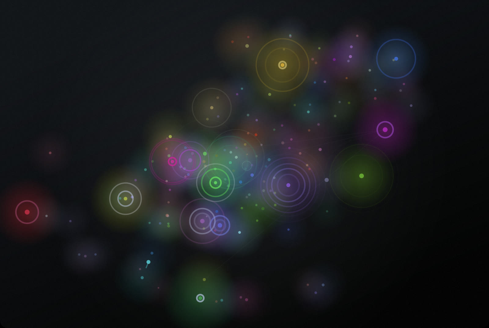

# Meshtastic Aether

[](LICENSE)
[](https://kotlinlang.org)

*The mesh, on the ether.* A slow piece of music and visuals that plays on its own and is nudged by live Meshtastic® traffic: packets are soft ornaments, nodes are voices, and mesh activity is the crowd. It targets desktop, Android, iOS and the web, and it only listens: nothing is sent to the mesh.

Meshtastic® is a registered trademark of Meshtastic LLC. Meshtastic Aether is a Meshtastic project.

## What this is

A Compose Multiplatform app on the [meshtastic-sdk](https://github.com/meshtastic/meshtastic-sdk), built with the [Kotlin Toolchain](https://kotlin-toolchain.org). It connects to a node over TCP, Bluetooth or WebSocket, or plays a scripted demo mesh, and turns what it hears into a generative score and a slowly rotating cloud of nodes. The piece sounds complete with no traffic at all; the mesh perturbs it.

The score and the instruments are synthesized in pure Kotlin on every target, with a per-platform audio output. The app has no dashboard, charts or node lists on the scene.

## Screenshots

The scene while it listens to a generated DEF CON mesh (150 simulated nodes, from the `defcon` preset of `meshtastic-mcp replay`): each orb is a node, each ring a packet, and the cloud rotates slowly in 3D.




## Run

```sh
./kotlin run -m desktopApp                      # desktop
./kotlin run -m desktopApp -- --fullscreen      # also: --demo, --replay, --tcp host[:port], --ask, --look standard|projector|oled
./kotlin run -m webApp                          # browser; tap to start audio
./kotlin run -m androidApp                      # device or emulator
./kotlin run -m iosApp                          # Mac only
./kotlin test -m shared -p jvm                  # shared tests (wasmJs: -p wasmJs)
```

The `./kotlin` wrapper downloads the Kotlin Toolchain on first use. [`CONTRIBUTING.md`](CONTRIBUTING.md) lists the build and test commands.

## Connect

The connect screen opens on a connected group of toggle buttons that picks one link type at a time: Demo, Network (TCP), Bluetooth and WebSocket. A target lists only the types it supports: Network is desktop, Android and iOS, and Bluetooth is not on web. The group opens on Demo, or on the type of the saved link.

- Demo: a scripted five-minute mesh, no node needed. The button reads Start the demo, and `--demo` does the same at launch.
- Network: a host field and a port field (digits only; a blank port means 4403), then Connect over TCP. `--tcp host[:port]` connects at launch on desktop.
- Bluetooth: Scan for Bluetooth radios lists each node by name, the last five characters of its address and a signal word (Strong, Good, Fair, Weak or Signal unknown). Tapping a radio connects, so this pane has no connect button.
- WebSocket: a `ws://` or `wss://` address, then Connect over WebSocket.
- A connect button stays disabled while its fields are invalid, and the field says why. The Go key on the keyboard submits from the TCP port and the WebSocket address.
- An unreachable host shows `Can't reach host:port - retrying` in the status line, and the raw error goes to the log. A link that fails to start shows its reason on the connect screen.

Desktop, Android and iOS remember the last demo, TCP or WebSocket link. On the next launch a banner reads `Connecting to host:port in N s` (or `Starting the demo in N s`) over a wavy progress bar that fills across 5 s, with Connect now and Cancel. Connect now starts whatever the screen shows, and it is absent while the fields are invalid or Bluetooth is selected. Cancel stops the countdown, and so does any edit to a field or any change of link type. A Bluetooth pick and `--replay` are not saved and leave the saved link as it was.

`--ask` shows the connect screen with no countdown: it ignores the saved link and any `--demo`, `--replay` or `--tcp` on the same command line. A bad `--tcp` or `--look` value shows its error and starts no link.

The layout follows the window width. Under 600 dp it is one column with the connect button pinned to the bottom. From 600 to 839 dp the column is capped at 560 dp and the host and port fields sit side by side. At 840 dp and wider, or in a window shorter than 480 dp, it splits into two panes: the glyph, name, tagline and countdown banner on one side, and a card with the link types and fields on the other.

## Controls

Click or tap the scene, or press H, to show the HUD. It is hidden while the piece plays and draws nothing until opened. The pointer hides after 3 s without movement, and for the first 8 s a faint line reads `Click or press H for controls` (`Tap for controls` without a keyboard).

The HUD has a status card at the top left (link, node count, key and mode, section, any error, and the shortcut line where a keyboard is the usual input) and a floating toolbar at the bottom center. The toolbar holds, in order:

- Mute: a toggle that shows a speaker, or a crossed speaker while muted. It takes focus when the HUD opens.
- Volume: a slider. Moving it unmutes.
- Look: three radio buttons for Standard, Projector and OLED night, the selected one filled.
- Drivers: a toggle that lists each mesh-driven parameter with its live value and driver. The panel sits at the right on windows 840 dp and wider, and above the toolbar (up to half the window height) on narrower ones.
- Fullscreen: only where the host has a switch (desktop).
- Disconnect: the power glyph, in the error color.

Under 600 dp the toolbar splits into two rows, volume and look above the actions. With a keyboard each button shows a tooltip with its name.

The HUD hides after 15 s without input, or 60 s while Drivers is open, and it waits while a control is focused or pressed or a screen reader is on.

Disconnect takes two presses within 3 s, from the toolbar button or the D key. The first press tints the button with the error container, shows `Press Disconnect again within 3 seconds` above the toolbar and, for the key, opens the HUD. The second press ends the session and returns to the connect screen with no countdown. After 3 s the first press lapses.

Haptics fire where the device has them: a confirmed Disconnect plays a confirm tick, and a mute change plays a toggle-on or toggle-off tick, whether it came from the button, the M key or the slider.

Volume and mute are remembered, and each session ramps the master from silence over 3 s. `--look` picks the palette for that launch (Standard, Projector or OLED night). With `--fullscreen` and no saved choice the look is Projector, otherwise Standard.

A small status line at the top center names a link that is not settled: Connecting, Listening (warming up), `Link lost - retrying`, or the open error. It shows for 10 s after its text changes, then for 10 s at the start of each minute, at one of four heights in turn so it never sits on the same pixels. The HUD names every state: Connecting, Listening, Connected, Demo mesh, Replaying a capture, Link lost.

| Key | Action |
| --- | --- |
| H | HUD |
| F | fullscreen (desktop) |
| M | mute |
| Up, Down | volume |
| D | disconnect (press twice within 3 s) |
| Esc | close the HUD, else leave fullscreen |

On macOS the menu bar mirrors the keys: File has Disconnect, View has Enter Full Screen (Ctrl+Cmd+F) and Mute or Unmute, and Window has Minimize. Disconnect and Mute are enabled while a session runs, and Disconnect asks for the same second press as the D key. Windows and Linux draw no menu bar over the picture. On Android, Back closes the HUD, then returns from the scene to the connect screen, then leaves the app.

## Design

The UI follows Material 3 Expressive with the standard motion scheme. The piece is calm, so motion never overshoots: the expressive scheme's springs bounce, and the standard scheme settles without it. The toolbar uses the standard floating-toolbar colors, because the vibrant ones fill a wide slab with saturated green that would burn into an OLED screen or a projector left on for days. Components still use the Expressive shapes: connected toggle buttons, a floating toolbar, wavy progress and a loading indicator. Colors come from Material roles on the standards' dark scheme. The theme is dark-only, which waives the standards' light theme and dynamic color (see Branding).

## Mesh-driven parameters

The mesh turns parameters in three layers, and every parameter holds its neutral value until the mesh says otherwise.

- Per event: each packet's own facts shape its note and ripple. The node's role and hardware pick the instrument, and hops, SNR, RSSI, MQTT, position and altitude, battery, payload size and text length (never the text) shape how it sounds.
- Landscape: slow signals from the whole mesh (activity, surge, silence, reach, link quality, senders, chat, arrivals, weather), each scaled against its own rolling 24 h range, so a quiet mesh still reads against its own history. A signal with no data keeps its neutral value. They turn the rotation, phrase speed, mode lean and the pull toward pentatonic.
- Rotation: the speed, angle and direction of the cloud, integrated so nothing jumps.

The clock skeleton stays under the mesh: weekday picks the key, and time of day picks the mode and register, with the hour chime, dawn and dusk, the night dim and the long form.

The palette is about 15 instruments, 8 scales (never Locrian) and 4 tempo bands. The Drivers button in the HUD lists each parameter with its live value, unit and the signal driving it, or a plain note such as `holding 8.0 deg - no wind reports` when its signal has no data. The demo sweeps these inputs in five minutes, including a pressure fall that reverses the rotation once per session.

[`docs/mesh-driven-parameters.md`](docs/mesh-driven-parameters.md) has the instruments, scales, signals, mappings and rotation rules.

## Branding

The icon is an own glyph in the brand palette: a luminous green orb with a tilted orbit ring and bright nodes. It is not the Meshtastic M mark, which is never altered or recolored. The sources are `branding/icon.svg`, `branding/icon-small.svg` and `branding/icon-foreground.svg`, and `scripts/icons.sh` regenerates the iOS, desktop and web raster assets from them. The Android icon is hand-ported VectorDrawable XML that follows the foreground source.

The app is dark-only by design: it is a calm projector and night piece. The design standards ask for light and dark themes and for dynamic color on Android 12+, and both are waived here. The name is written as `Meshtastic Aether`.

## Logs

Desktop writes `aether.log` (and stdout) to `$XDG_STATE_HOME/meshtastic-aether/` or `~/.local/state/meshtastic-aether/` on Linux and `~/Library/Logs/MeshtasticAether/` on macOS, and keeps one older generation as `aether.log.1`. Android logs to logcat under `MeshtasticAether`, and web logs to the browser console.

The log records the session link, link state changes, Bluetooth scan results, failures, and key and mode changes. A `coverage` line follows ten minutes after the link comes up and then hourly: the distinct nodes reporting each telemetry field, the role and hardware mix, and whether the connected node reports LocalStats. One line a minute records packets heard by kind, notes scheduled, link, key, mode, section and volume.

## Tools

```sh
./kotlin run -m tools -- sparse 1 /tmp/sparse.wav   # silent | sparse | busy, hours, output [seed]
./kotlin run -m tools -- analyze /tmp/sparse.wav    # per-window peak, RMS, clipping, centroid
./kotlin run -m blescan -- 15                       # scan for nodes for 15 s, print what is found
```

The render tool runs the simulated mesh through the composer and synth offline. Real captures stay local (`captures/` is ignored).

## Troubleshooting

- Headless over ssh: the desktop app needs a display, so use the render tool to produce a WAV file instead.
- Bluetooth permission: Android asks for Bluetooth scan and connect permission on the first scan, and without it the scan does not start and the log says so. macOS and Linux need Bluetooth enabled and permitted for the terminal or app.
- Silent on web: browsers block audio until a gesture, so tap the start screen.
- No sound on desktop: check M (mute) and the volume in the HUD.

## Verified on

| Target | Built | Tests | Run |
| --- | --- | --- | --- |
| jvm (Linux) | yes | 602 shared tests pass (524 common, 78 jvm only) | offline renders only on Linux |
| jvm (macOS, M4) | yes | - | 6 h live run against a real mesh (about 210 nodes): 59.9 fps, p95 18 ms, 340 MB, about 27% of one core, LocalStats delivered, no warnings |
| wasmJs | compiles (`./kotlin build`) | run with `-p wasmJs`; check for `ERROR` lines | never run in a browser |
| android | compiles | not run | never run on a device |
| iOS | shared and its tests compile for the simulator | not run | never run |
| Bluetooth | - | - | not exercised on a live node |

The live run was watched through the log and frame statistics; no person has judged the sound or the visuals from it. The real mesh sent no pressure or wind reports (6 nodes with temperature, 20 with battery), so those paths are proven only by tests and the demo.

## Documentation

- [`docs/design.md`](docs/design.md): goals, constraints, how the app works and what is built.
- [`docs/mesh-driven-parameters.md`](docs/mesh-driven-parameters.md): how the mesh turns the parameters.
- [`docs/prior-art.md`](docs/prior-art.md): the survey of prior work and licenses behind the design.
- [`AGENTS.md`](AGENTS.md): architecture and rules for coding agents.
- [`CONTRIBUTING.md`](CONTRIBUTING.md): build, test and submit a change.

## Credits

The app is inspired by *Sonorous Reception* (190 South LaSalle, Chicago, 2022), a lobby sound sculpture by iart with sound design by Idee und Klang, whose generative score follows the hour, the weekday and the weather. [`NOTICE`](NOTICE) lists the ported code and its licenses.

## Contributing

Sign every commit with the Developer Certificate of Origin (DCO):

```shell
git commit -s -m "Your message"
```

[`CONTRIBUTING.md`](CONTRIBUTING.md) has the full flow.

## License

GPL-3.0-or-later. See [`LICENSE`](LICENSE).

## Related Meshtastic projects

- [meshtastic.org](https://meshtastic.org): the project site and documentation.
- [`meshtastic/meshtastic-sdk`](https://github.com/meshtastic/meshtastic-sdk): the Kotlin Multiplatform SDK this app links to a node with.
- [`meshtastic/Meshtastic-Android`](https://github.com/meshtastic/Meshtastic-Android) and [`meshtastic/Meshtastic-Apple`](https://github.com/meshtastic/Meshtastic-Apple): the Android and Apple clients.
- [Design standards](https://github.com/meshtastic/design/tree/master/standards): the standards the clients implement.
